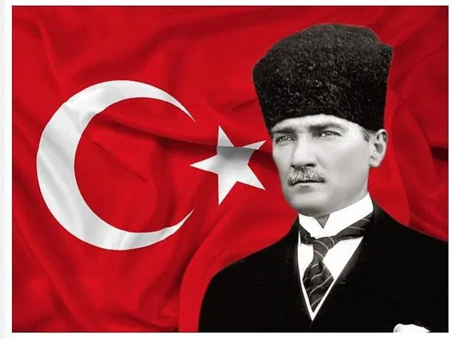
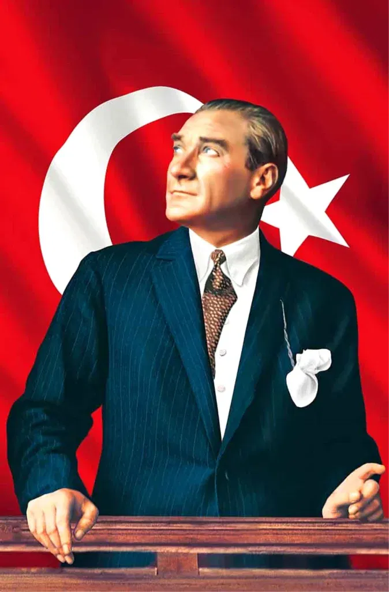

# Atatürk & Türkiye Yazı Sanatı 🇹🇷

Python ile üretilmiş iki yazı sanatı çalışması. İkisi de görseli "TÜRKİYE" kelimesinin harfleriyle çiziyor.[cite: 3]

<p align="center">
  
  
</p>

## 1. Atatürk Spirali[cite: 3]

Atatürk fotoğrafı ve Türk bayrağı, spiral boyunca dizilen "TÜRKİYE" harfleriyle çizilir. Bayrak koddan çizilir, harflerin renkleri fotoğraftan alınır.[cite: 3]

▶️ **Çalıştırmak için:** `ATATURK.py` dosyasını aç ve çalıştır. (`ataturk.png` aynı klasörde olmalı.)[cite: 3]

## 2. Türkiye Spirali[cite: 3]

Herhangi bir fotoğrafı spiral yazıya çevirir. Varsayılan görsel `Türkiye.png` ; istersen kendi fotoğrafını seçebilirsin.[cite: 3]

▶️ **Çalıştırmak için:** `Türkiye.py` dosyasını aç ve çalıştır. (`Türkiye.png` aynı klasörde olmalı.)[cite: 3]

## Kontroller[cite: 3]

* `s` - kaydet[cite: 3]
* `r` - baştan başlat[cite: 3]
* `Esc` - çık[cite: 3]

## Gereksinimler[cite: 3]

```bash
pip install pillow numpy
```
## Atıf / Teşekkür
Bu proje, **[iremcnar](https://github.com/iremcnar)** tarafından geliştirilen çalışmadan ilham alınarak hazırlanmıştır. Orijinal projeye katkılarından dolayı teşekkür ederim.
